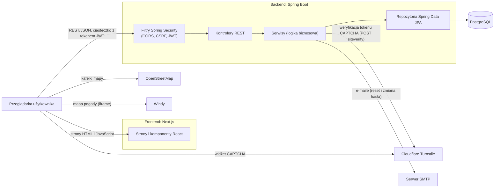
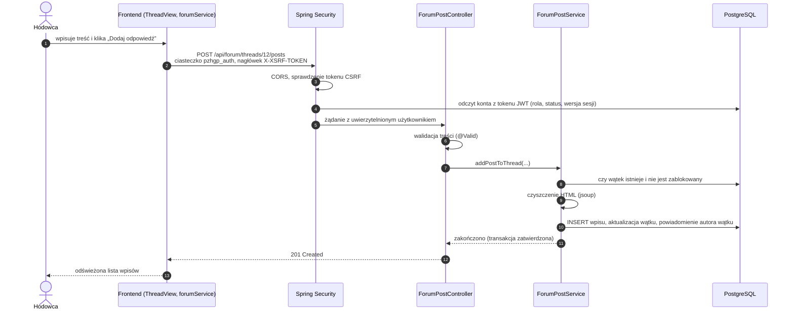

# Architektura

## Przegląd

Aplikacja działa w architekturze klient–serwer i składa się z trzech głównych części:

- **frontend:** aplikacja Next.js (React) wyświetlana w przeglądarce;
- **backend:** API REST w Spring Boot, które zawiera całą logikę biznesową i reguły uprawnień;
- **baza danych:** PostgreSQL, której schemat tworzą migracje Flyway.

Przeglądarka pobiera strony z serwera Next.js, a dane wymienia **bezpośrednio z backendem** w formacie JSON. Serwer Next.js nie pośredniczy w zapytaniach do API i nie pobiera danych po swojej stronie. Wszystkie dane są pobierane w przeglądarce, po zalogowaniu użytkownika.



## Technologie

| Obszar | Technologia | Wersja | Zastosowanie |
|---|---|---|---|
| Backend | Java | 25 (LTS) | język backendu |
| | Spring Boot | 4.1 | Web MVC, Security, Data JPA, Validation, Mail, Actuator |
| | Hibernate ORM | 7.4 | mapowanie encji na tabele |
| | Flyway | 12.4 | wersjonowane migracje schematu bazy |
| | JJWT | 0.13 | tworzenie i weryfikacja tokenów JWT |
| | jsoup | 1.24 | czyszczenie HTML z edytora tekstu |
| | Lombok | 1.18 | skrócenie kodu encji (gettery, settery, konstruktory) |
| Baza danych | PostgreSQL | 16 lub nowszy (w Dockerze 18) | relacyjna baza danych |
| Frontend | Next.js (App Router) | 16.4 | framework aplikacji React, routing, budowanie |
| | React | 19.3 | komponenty interfejsu |
| | TypeScript | 5.9 | typowanie kodu frontendu |
| | Tailwind CSS | 4.3 | style |
| | TipTap | 3.34 | edytor tekstu sformatowanego (ogłoszenia, forum) |
| | Leaflet, React Leaflet | 1.9, 5.0 | mapa trasy lotu |
| | DOMPurify | 3.4 | czyszczenie HTML przed wyświetleniem |
| Testy | JUnit (Jupiter) | 6.0 | testy backendu |
| | Mockito | 5.23 | atrapy zależności w testach jednostkowych |
| | Spring MockMvc | 7.0 | testy integracyjne API |
| | JaCoCo | 0.8.16 | raport pokrycia kodu testami |
| | Cypress | 15.21 | testy end-to-end interfejsu |
| Narzędzia | Maven (wrapper) | 3.9 | budowanie backendu |
| | npm | 11 (Node.js 26 LTS) | budowanie frontendu |
| | Docker, Docker Compose | – | uruchomienie całości w kontenerach |

## Backend

### Warstwy

Backend ma klasyczną architekturę warstwową. Każda warstwa korzysta tylko z warstwy pod nią:

| Warstwa | Pakiet | Odpowiedzialność |
|---|---|---|
| Kontrolery | `controller/` | przyjmują żądania HTTP, walidują dane (`@Valid`), wywołują serwisy, zwracają kod odpowiedzi |
| Serwisy | `service/` | logika biznesowa, reguły uprawnień, transakcje (`@Transactional`), integracje zewnętrzne |
| Repozytoria | `repository/` | dostęp do bazy przez Spring Data JPA (zapytania z nazw metod i `@Query`) |
| Encje | `entity/` | klasy mapowane na tabele bazy, typy wyliczeniowe (role, statusy) |
| DTO | `dto/` | rekordy żądań i odpowiedzi API; encje nigdy nie są zwracane bezpośrednio |
| Konfiguracja | `config/` | Spring Security, filtr JWT, ciasteczko logowania, wysyłka asynchroniczna, zegar |
| Wyjątki | `exception/` | własne wyjątki i `GlobalExceptionHandler`, który zamienia je na kody HTTP |
| Narzędzia | `utils/` | czyszczenie HTML, normalizacja numerów obrączek, stronicowanie, nazwy plików, hasła |
| Analiza GPX | `service/gpx/` | parser plików GPX, analiza lotu, geometria na kuli ziemskiej, upraszczanie trasy |

### Ważniejsze decyzje projektowe

- **Rekordy DTO zamiast encji w API.** Odpowiedzi zawierają tylko potrzebne pola. Pola uprawnień, np. `canEdit` i `canDelete`, liczy backend, więc frontend nie powtarza reguł uprawnień.
- **Bezstanowy backend.** Nie ma sesji po stronie serwera. Użytkownika rozpoznaje token JWT w ciasteczku `HttpOnly`, a przy każdym żądaniu backend sprawdza w bazie rolę, status i wersję sesji konta (szczegóły w rozdziale [Bezpieczeństwo](bezpieczenstwo.md)).
- **Błędy jako zwykły tekst.** Każdy błąd ma odpowiedni kod HTTP i treść `text/plain` z komunikatem po polsku, który frontend pokazuje użytkownikowi bez dodatkowego tłumaczenia.
- **`spring.jpa.open-in-view=false`.** Encje są zamieniane na DTO wewnątrz transakcji serwisu, więc po jej zakończeniu nic nie jest doczytywane z bazy.
- **Wstrzykiwany zegar (`Clock`).** Kod zależny od czasu, np. limity prób, korzysta z beana `Clock`, dzięki czemu testy mogą „przesuwać czas”.
- **Wysyłka e-maili w tle.** Metody `MailService` są oznaczone `@Async`, więc wolny serwer SMTP nie opóźnia odpowiedzi API.
- **Schemat bazy z migracji.** Tabele tworzy Flyway, a Hibernate działa w trybie `validate`, czyli tylko sprawdza zgodność encji ze schematem (rozdział [Baza danych](baza-danych.md)).

## Frontend

### Struktura

| Katalog (`frontend/src/app/`) | Zawartość |
|---|---|
| `(auth)/` | strony logowania, rejestracji, odzyskiwania i ustawiania nowego hasła, bez paska nawigacji |
| `(main)/` | pozostałe strony z paskiem nawigacji (`Navbar`) i stopką (`Footer`) |
| `components/` | komponenty wielokrotnego użytku: okna modalne, edytor tekstu, mapa lotu, wykres profilu lotu, widżet CAPTCHA, stronicowanie |
| `services/` | 11 serwisów komunikacji z API, po jednym na obszar (konta, administrator, ogłoszenia, logowanie, zarząd, plany lotów, loty GPX, forum, znalezione gołębie, powiadomienia, sekcje) |
| `utils/` | klient API (`apiClient.ts`), stan sesji, formatowanie dat i liczb, walidacja haseł, metadane stron |
| `hooks/` | `useLatestRequest` (pomija nieaktualne odpowiedzi) i `useConfirmDialog` (okno potwierdzenia) |
| `types/` | typy TypeScript odpowiadające DTO backendu |

Nawiasy w nazwach `(auth)` i `(main)` oznaczają w Next.js **grupy tras**: porządkują pliki i nadają wspólny układ strony, ale nie zmieniają adresów URL.

### Ważniejsze decyzje projektowe

- **Jedna warstwa komunikacji z API.** Strony nie wywołują `fetch` bezpośrednio, tylko funkcje serwisów. Serwisy korzystają ze wspólnych funkcji `requestJson`, `requestVoid`, `requestText` i `requestCreatedId` w `utils/apiClient.ts`, które:
  - dodają adres backendu i nagłówek CSRF;
  - zamieniają dane na JSON albo przesyłają pliki jako `FormData`;
  - zgłaszają błąd z komunikatem serwera, gdy odpowiedź ma kod błędu;
  - po odpowiedzi 401 przenoszą na stronę logowania (z wyjątkiem endpointów publicznych).
- **Stan zalogowanego użytkownika.** `AuthProvider` pobiera dane z `GET /api/auth/me`, a `AuthGuard` blokuje strony wymagające logowania lub konkretnej roli. To tylko wygoda interfejsu: o dostępie zawsze decyduje backend.
- **Ochrona przed nieaktualnymi odpowiedziami.** Gdy użytkownik szybko zmienia stronę, filtr albo okno, `useLatestRequest` sprawia, że odpowiedź na wcześniejsze zapytanie nie nadpisze nowszych danych.
- **Walidacja identyfikatorów w adresie.** Strony z identyfikatorem w adresie (np. `/forum/thread/12`) mają serwerowy plik `page.tsx`, który sprawdza poprawność identyfikatora i przy błędnym wyświetla stronę 404, oraz kliencki komponent `…View.tsx` z właściwą treścią.

## Przepływ typowego żądania

Przykład: zalogowany hodowca dodaje odpowiedź na forum.



Szczegółowy przebieg rejestracji z weryfikacją CAPTCHA w zewnętrznym API opisuje rozdział [Integracja z Cloudflare Turnstile](integracja-turnstile.md).

## Struktura repozytorium

```
pzhgp-zagan/
├── backend/                            # API REST (Spring Boot)
│   ├── src/main/java/com/pzhgp/backend/
│   │   ├── config/                     # bezpieczeństwo, JWT, ciasteczka, konfiguracja
│   │   ├── controller/                 # endpointy REST
│   │   ├── dto/                        # rekordy żądań i odpowiedzi
│   │   ├── entity/                     # encje JPA i typy wyliczeniowe
│   │   ├── exception/                  # wyjątki i ich obsługa
│   │   ├── repository/                 # repozytoria Spring Data
│   │   ├── service/                    # logika biznesowa (w tym gpx/ – analiza lotów)
│   │   └── utils/                      # funkcje pomocnicze
│   ├── src/main/resources/
│   │   ├── application.properties      # konfiguracja aplikacji
│   │   └── db/migration/               # migracje Flyway (V1, V2, V3)
│   ├── src/test/                       # testy jednostkowe i integracyjne
│   ├── Dockerfile
│   └── .env.example                    # przykładowe zmienne środowiskowe backendu
├── frontend/                           # interfejs użytkownika (Next.js)
│   ├── cypress/                        # testy end-to-end
│   ├── src/app/                        # strony, komponenty, serwisy, typy
│   ├── Dockerfile
│   └── .env.local.example              # przykładowe zmienne środowiskowe frontendu
├── docker/db-import/                   # miejsce na kopię bazy do wczytania w Dockerze
├── docs/                               # ta dokumentacja
├── docker-compose.yml                  # uruchomienie całości w kontenerach
└── .env.example                        # zmienne dla docker compose
```
