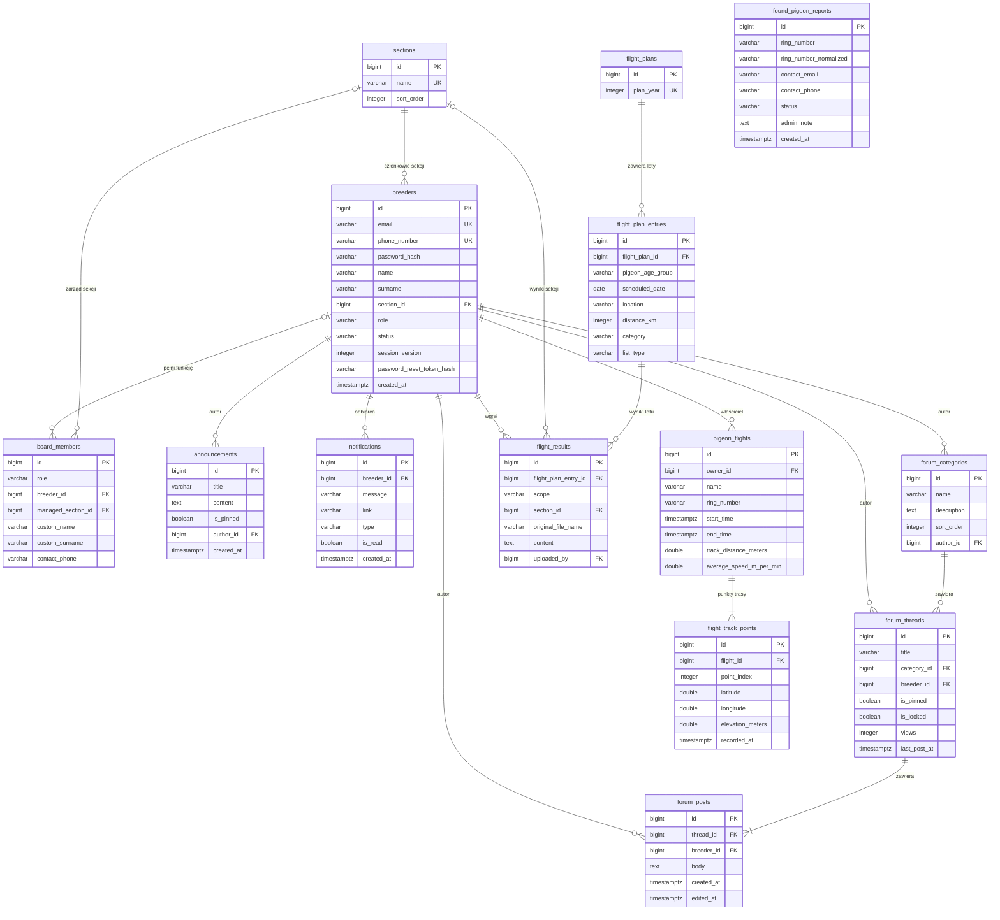

# Baza danych

Aplikacja korzysta z bazy **PostgreSQL**. Schemat bazy tworzą i zmieniają **migracje Flyway** zapisane w repozytorium. Hibernate (JPA) mapuje encje na tabele, ale sam niczego w schemacie nie zmienia: działa w trybie `validate` i przy starcie sprawdza tylko, czy encje zgadzają się z tabelami.

## Model danych



Diagram pokazuje najważniejsze kolumny. Pełna definicja jest w migracji `backend/src/main/resources/db/migration/V1__initial_schema.sql`.

## Tabele

| Tabela | Encja | Zawartość i ważniejsze ograniczenia |
|---|---|---|
| `sections` | `Section` | Cztery sekcje oddziału (Żagań, Wymiarki, Chotków, Kożuchów) dodawane przez migrację `V1`. Nazwa jest unikalna. |
| `breeders` | `Breeder` | Konta użytkowników. E-mail i telefon są unikalne. `role` to `BREEDER`, `MODERATOR` lub `ADMINISTRATOR`, a `status` to `PENDING`, `ACTIVE` lub `BLOCKED`. Hasło jest zapisane jako skrót BCrypt, a token resetu hasła jako skrót SHA-256. `session_version` służy do unieważniania sesji. |
| `board_members` | `BoardMember` | Członkowie zarządu. Pusta `managed_section_id` oznacza zarząd oddziału. Członek ma albo powiązanie z kontem (`breeder_id`), albo dane wpisane ręcznie (`custom_*`). |
| `announcements` | `Announcement` | Ogłoszenia; treść to oczyszczony HTML. |
| `notifications` | `Notification` | Powiadomienia użytkownika (`breeder_id` to odbiorca). Typ jest ograniczony regułą CHECK do wartości `NotificationType`. |
| `forum_categories` | `ForumCategory` | Kategorie forum z kolejnością `sort_order`. |
| `forum_threads` | `ForumThread` | Wątki z flagami przypięcia i blokady, licznikiem wyświetleń i datą ostatniego wpisu. |
| `forum_posts` | `ForumPost` | Wpisy w wątkach; pierwszy wpis jest treścią wątku. |
| `flight_plans` | `FlightPlan` | Plany lotów; jeden plan na rok (`uk_flight_plans_year`). |
| `flight_plan_entries` | `FlightPlanEntry` | Loty w planie: grupa wiekowa (`ADULT` lub `YOUNG`), data, miejscowość, dystans, kategoria i rodzaj listy. |
| `flight_results` | `FlightResult` | Pliki z wynikami: zasięg `BRANCH` (oddział) lub `SECTION` (sekcja, wtedy `section_id` wskazuje sekcję), treść pliku i autor. |
| `pigeon_flights` | `PigeonFlight` | Loty wgrane z plików GPX razem z wyliczonymi statystykami. |
| `flight_track_points` | `FlightTrackPoint` | Punkty trasy lotu w kolejności `point_index`; jeden lot ma zwykle kilka tysięcy punktów. |
| `found_pigeon_reports` | `FoundPigeonReport` | Zgłoszenia znalezionych gołębi. Nie są powiązane z kontami, bo zgłasza je osoba z zewnątrz. `ring_number_normalized` służy do wyszukiwania. |
| `flyway_schema_history` | – | Tabela techniczna Flyway z historią wykonanych migracji. |

**Klucze i czas:**
- **Klucze główne** są generowane przez bazę (`GENERATED BY DEFAULT AS IDENTITY`).
- **Znaczniki czasu** są zapisywane jako `timestamp with time zone` i mapowane na `java.time.Instant`. W bazie i w API czas jest w UTC, a na czas lokalny zamienia go przeglądarka.
- **Typy wyliczeniowe** są zapisywane jako tekst, a reguły CHECK w bazie pilnują dozwolonych wartości.

## Indeksy

Poza kluczami głównymi i unikalnymi baza ma indeksy pod najczęstsze zapytania. PostgreSQL nie tworzy indeksów na kluczach obcych automatycznie.

| Indeks | Kolumny | Zapytanie |
|---|---|---|
| `idx_notifications_recipient_read` | `notifications (breeder_id, is_read)` | liczba nieprzeczytanych powiadomień (przy każdej zmianie strony) i lista powiadomień |
| `idx_forum_posts_thread` | `forum_posts (thread_id, created_at)` | wpisy wątku i pierwszy wpis |
| `idx_forum_threads_category` | `forum_threads (category_id)` | wątki kategorii |
| `idx_flight_plan_entries_plan` | `flight_plan_entries (flight_plan_id)` | loty planu |
| `idx_flight_results_entry` | `flight_results (flight_plan_entry_id)` | wyniki lotu |
| `idx_pigeon_flights_owner` | `pigeon_flights (owner_id, uploaded_at)` | loty hodowcy od najnowszego |
| `idx_track_point_flight` | `flight_track_points (flight_id, point_index)` | punkty trasy lotu w kolejności |
| `idx_found_pigeon_ring` | `found_pigeon_reports (ring_number_normalized)` | wyszukiwanie zgłoszeń po numerze obrączki |
| `idx_found_pigeon_status` | `found_pigeon_reports (status)` | filtrowanie zgłoszeń po statusie |

## Migracje Flyway

Migracje są w katalogu `backend/src/main/resources/db/migration/`. Flyway wykonuje je przy starcie backendu, przed uruchomieniem Hibernate, i zapisuje wykonane wersje w tabeli `flyway_schema_history`.

| Plik | Zawartość |
|---|---|
| `V1__initial_schema.sql` | Wszystkie tabele, ograniczenia, klucze obce i cztery sekcje oddziału. Odpowiada schematowi, który wcześniej Hibernate tworzył automatycznie, łącznie z nazwami kluczy obcych. |
| `V2__align_schema_created_by_hibernate.sql` | Doprowadza bazę utworzoną wcześniej przez Hibernate (`ddl-auto=update`) do stanu z `V1`: flagi wątków bez wartości NULL, znaczniki czasu ze strefą czasową i aktualne listy wartości w regułach CHECK. W nowej bazie niczego nie zmienia. |
| `V3__add_indexes.sql` | Indeksy pod najczęstsze zapytania. |

### Baza utworzona przed wprowadzeniem Flyway (baseline)

Przed wprowadzeniem Flyway schemat tworzył Hibernate. Taka baza nie ma tabeli historii migracji. Dzięki ustawieniu `spring.flyway.baseline-on-migrate=true` Flyway oznacza ją przy pierwszym starcie jako wersję 1 (*baseline*), pomija `V1` i wykonuje tylko `V2` i `V3`, więc istniejące dane zostają. Pusta baza dostaje wszystkie migracje od `V1`.

### Zasady pracy z migracjami

- **Wykonanej migracji nie wolno edytować.** Flyway zapamiętuje sumy kontrolne plików i przy zmianie zatrzyma start aplikacji. Każda zmiana schematu to nowy plik z kolejnym numerem.
- **Zmiana encji i migracja idą razem.** Jeśli encja nie zgadza się z tabelą, Hibernate w trybie `validate` zatrzyma start i wskaże brakującą kolumnę albo zły typ.
- **Nazwa pliku:** `V<numer>__<opis>.sql`, np. `V4__add_breeder_nickname.sql`:

  ```sql
  ALTER TABLE breeders ADD COLUMN nickname VARCHAR(50);
  ```

- **Testy sprawdzają migracje.** Przed testami baza testowa jest czyszczona i budowana od zera wszystkimi migracjami (rozdział [Testy](testy.md)), więc błędna migracja od razu wychodzi w testach.

## Bazy w różnych środowiskach

| Środowisko | Baza | Uwagi |
|---|---|---|
| Uruchomienie lokalne | `pzhgp_zagan` na lokalnym PostgreSQL | adres i dane logowania w `backend/.env` |
| Testy backendu | `pzhgp_zagan_test` | czyszczona przed testami; nazwa musi kończyć się na `_test` |
| Docker | `pzhgp_zagan` w kontenerze PostgreSQL 18 | dane w wolumenie `db-data`; kopię można wczytać z katalogu `docker/db-import/` |

## Kopia zapasowa i odtworzenie

```bash
# kopia w formacie PostgreSQL (do odtworzenia przez pg_restore)
pg_dump -U postgres -d pzhgp_zagan -F c -f pzhgp_zagan.dump

# odtworzenie do pustej bazy
pg_restore -U postgres -d pzhgp_zagan --no-owner pzhgp_zagan.dump

# kopia jako plik SQL, np. do wczytania w Dockerze
pg_dump -U postgres -d pzhgp_zagan --no-owner --no-privileges -f docker/db-import/pzhgp_zagan.sql
```

Kopię trzeba wczytywać do **pustej** bazy, zanim backend zostanie uruchomiony. Inaczej Flyway utworzy własne tabele, a kopia się z nimi zderzy.
