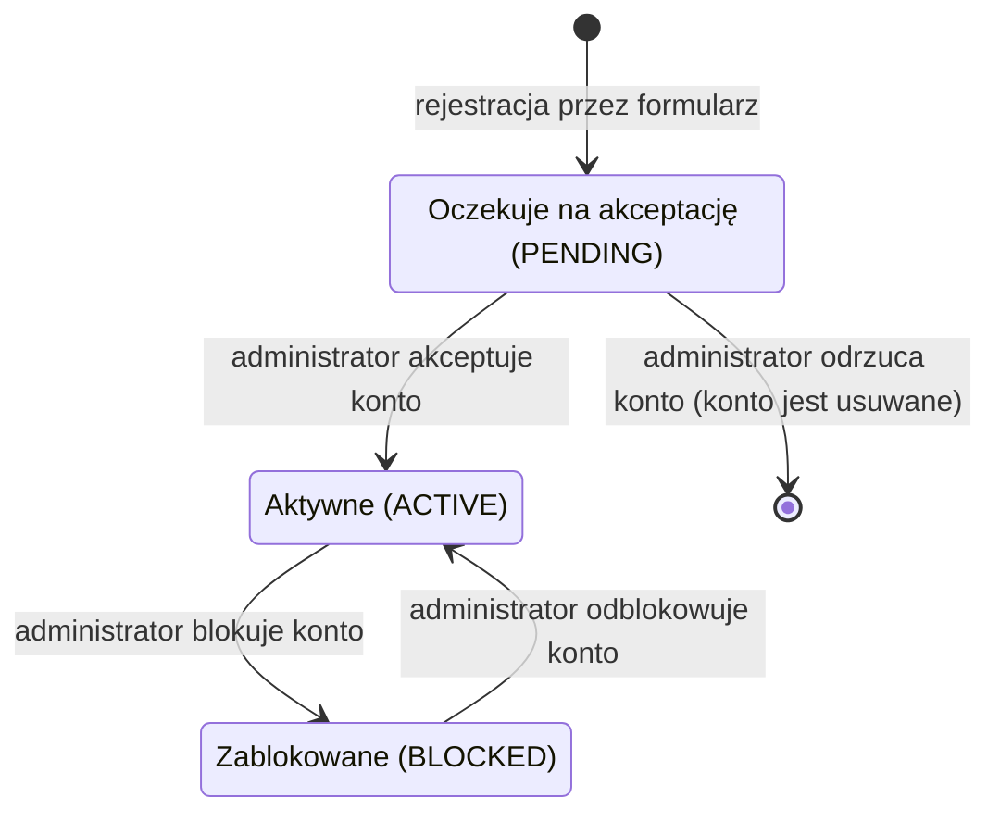
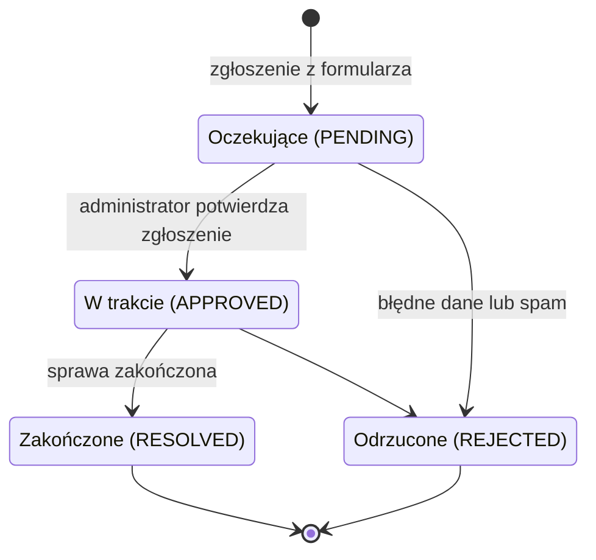

# Funkcje i reguły biznesowe

Ten rozdział opisuje, co robi każdy moduł aplikacji i jakie reguły egzekwuje backend. Opis obsługi z punktu widzenia użytkownika jest w [instrukcji użytkownika](instrukcja-uzytkownika.md).

## Role i uprawnienia

Aplikacja rozróżnia gościa (osobę niezalogowaną) i trzy role kont: **hodowca** (`BREEDER`), **moderator** (`MODERATOR`) i **administrator** (`ADMINISTRATOR`). Każde nowe konto dostaje rolę hodowcy.

| Funkcja | Gość | Hodowca | Moderator | Administrator |
|---|:---:|:---:|:---:|:---:|
| Ogłoszenia, skład zarządu, pogoda, zgłoszenie znalezionego gołębia | ✓ | ✓ | ✓ | ✓ |
| Plany i wyniki lotów (przeglądanie), forum, ustawienia konta, powiadomienia | | ✓ | ✓ | ✓ |
| Mapy lotów GPX | | własne | własne | własne i cudze (podgląd, usuwanie) |
| Dodawanie ogłoszeń, tworzenie kategorii forum | | | ✓ | ✓ |
| Przypinanie i blokowanie wątków | | | własnych i hodowców | wszystkich |
| Usuwanie wątków i wpisów na forum | | własnych | własnych i hodowców | własnych, hodowców i moderatorów |
| Usuwanie ogłoszeń | | | własnych | własnych, moderatorów (autor dostaje powiadomienie) |
| Konta użytkowników, zarząd, plany i wyniki lotów (zarządzanie), zgłoszenia znalezionych gołębi, usuwanie kategorii forum | | | | ✓ |

Zasady hierarchii są zebrane w klasie `service/PermissionRules.java`:
- autor zawsze może usunąć to, co sam napisał;
- moderator może usuwać treści hodowców;
- administrator może usuwać treści hodowców i moderatorów, ale nie innych administratorów.

Edytować wpis, tytuł wątku albo ogłoszenie może tylko jego autor.

Uprawnienia są sprawdzane dwa razy:
- **w `SecurityConfig`** według roli i adresu endpointu;
- **w serwisach**, gdzie decyzja zależy od konkretnego rekordu, np. czy użytkownik jest autorem wpisu albo właścicielem lotu.

Frontend dostaje gotowe pola `canEdit`, `canDelete` i `canModerate` i na ich podstawie pokazuje lub ukrywa przyciski.

## Konta użytkowników

### Cykl życia konta

- **Rejestracja** (`POST /api/auth/register`):
  - wymaga weryfikacji CAPTCHA i podlega limitowi 5 prób na godzinę z jednego adresu IP;
  - e-mail i numer telefonu muszą być unikalne;
  - hasło musi mieć co najmniej 8 znaków, w tym małą i wielką literę, cyfrę oraz znak specjalny;
  - hasło jest zapisywane wyłącznie jako skrót BCrypt.
- **Akceptacja:** zmienia status na aktywny i wysyła powiadomienie „konto zaakceptowane”. Tylko aktywne konto może się zalogować.
- **Odrzucenie:** dotyczy wyłącznie kont oczekujących i fizycznie usuwa konto z bazy.
- **Blokada:** dotyczy tylko kont aktywnych i działa natychmiast, także dla już zalogowanych sesji. Administrator nie może zablokować innego administratora.
- **Zmiana roli:** możliwa tylko między hodowcą a moderatorem, nie dla kont oczekujących ani dla administratorów. Wybranie tej samej roli niczego nie zmienia i nie wysyła powiadomienia.
- **Pierwsze konto administratora** nadaje się ręcznie w bazie (rozdział [Uruchomienie](uruchomienie.md#pierwsze-konto-administratora)).

### Logowanie i sesja

- **Czas sesji:** bez opcji **Zapamiętaj mnie** ciasteczko jest usuwane po zamknięciu przeglądarki, a token wygasa najpóźniej po 24 godzinach. Z tą opcją sesja trwa 30 dni.
- **Unieważnianie sesji:** zmiana hasła i opcja **Wyloguj ze wszystkich urządzeń** natychmiast kończą wszystkie sesje konta (rozdział [Bezpieczeństwo](bezpieczenstwo.md#wersja-sesji-i-natychmiastowe-wylogowanie)).
- **Powrót po zalogowaniu:** po zalogowaniu użytkownik wraca na stronę, z której został przekierowany do logowania.

### Odzyskiwanie hasła

1. Użytkownik podaje adres e-mail i rozwiązuje CAPTCHA (`POST /api/auth/forgot-password`).
2. Jeśli konto istnieje, backend tworzy losowy token (32 bajty), zapisuje w bazie tylko jego skrót SHA-256 i wysyła e-mail z linkiem ważnym **30 minut**.
3. Odpowiedź jest taka sama niezależnie od tego, czy konto istnieje, więc formularza nie da się użyć do sprawdzania, kto ma konto.
4. Link otwiera stronę `/reset-password`, gdzie użytkownik ustawia nowe hasło (`POST /api/auth/reset-password`). Token jest jednorazowy, a zmiana hasła kończy wszystkie sesje.

### Ustawienia konta (`/settings`)

| Sekcja | Zawartość |
|---|---|
| Konto | rola, data założenia konta, staż w serwisie, funkcje pełnione w zarządzie |
| Dane osobowe | imię, nazwisko, data urodzenia, e-mail, sekcja (tylko do odczytu) |
| Dane kontaktowe | telefon i adres; użytkownik zmienia je sam |
| Zmiana hasła | wymaga obecnego hasła; po zmianie wysyłany jest e-mail z potwierdzeniem i kończą się wszystkie sesje |
| Sesje | **Wyloguj ze wszystkich urządzeń** |
| Twoje dane | **Pobierz moje dane**: plik JSON z danymi konta, ogłoszeniami, wątkami, wpisami i lotami użytkownika (prawo dostępu do danych z RODO) |

## Ogłoszenia (strona główna)

- **Lista:** jest publiczna i stronicowana (10 ogłoszeń na stronę). Przypięte ogłoszenia są na początku, a dalej od najnowszych.
- **Dodawanie:** moderator lub administrator, z edytorem tekstu sformatowanego (TipTap) i opcją przypięcia. Wszyscy aktywni użytkownicy oprócz autora dostają powiadomienie.
- **Edycja i usuwanie:** według tabeli uprawnień. Gdy administrator usuwa ogłoszenie moderatora, autor dostaje powiadomienie.
- **Treść HTML:** jest czyszczona na serwerze (jsoup, tylko dozwolone znaczniki) i ponownie w przeglądarce (DOMPurify).

## Forum

| Element | Reguły |
|---|---|
| **Kategorie** | Tworzy je moderator lub administrator. Edytować może autor, a administrator także kategorie innych osób poza administratorami. Usuwa tylko administrator i tylko kategorię bez wątków. Kolejność wyznacza pole `sortOrder`. |
| **Wątki** | Tworzy każdy zalogowany użytkownik, razem z pierwszym wpisem. Licznik wyświetleń rośnie przy każdym otwarciu. Tytuł zmienia tylko autor. Lista jest stronicowana (15 na stronę): najpierw przypięte, potem według daty ostatniego wpisu. |
| **Przypinanie i blokowanie** | Według hierarchii z `PermissionRules`. Zablokowany wątek nie przyjmuje nowych odpowiedzi. |
| **Wpisy** | Odpowiedzi są stronicowane (20 na stronę). Edytować może tylko autor (wpis dostaje znacznik edycji). Pierwszego wpisu nie da się usunąć osobno, bo usuwa się go razem z całym wątkiem. |
| **Powiadomienia** | Nowy wątek: wszyscy aktywni użytkownicy oprócz autora. Nowa odpowiedź: autor wątku, jeśli odpowiada ktoś inny. |

## Plany i wyniki lotów

### Plany lotów

- **Lista:** zalogowani użytkownicy widzą plany wszystkich sezonów. Plan danego roku zawiera loty osobno dla **gołębi dorosłych** i **gołębi młodych**.
- **Zarządzanie:** tylko administrator.
  - Na jeden rok przypada jeden plan; unikalność pilnuje też ograniczenie w bazie.
  - Lot w planie ma: datę (musi należeć do roku planu), miejscowość wypuszczenia, dystans w km, opcjonalną kategorię i rodzaj listy.
  - Lot z wgranymi wynikami można usunąć dopiero po usunięciu wyników. Plan można usunąć dopiero, gdy nie zawiera lotów.
- **Powiadomienie:** po utworzeniu planu dostają je wszyscy aktywni użytkownicy.

### Wyniki lotów

- **Format pliku:** zwykły plik tekstowy `.txt` w UTF-8, najwyżej 5 MB, z kolumnami wyrównanymi spacjami, tak jak w programach do obliczania wyników. Pliki binarne i puste są odrzucane, a nazwa pliku jest oczyszczana.
- **Rodzaje wyników:**
  - **oddziałowe:** najwyżej jedne dla danego lotu;
  - **sekcyjne:** najwyżej jedne dla każdej sekcji w danym locie.

  Wgrywanie jest zabezpieczone blokadą wiersza lotu w bazie, więc dwa jednoczesne żądania nie utworzą duplikatu.
- **Podgląd i pobieranie:** wyniki otwierają się w oknie podglądu czcionką o stałej szerokości, z przyciskiem **Pobierz plik**.
- **Powiadomienia:** o wynikach oddziałowych dostają je wszyscy aktywni użytkownicy, a o wynikach sekcyjnych tylko aktywni członkowie danej sekcji. Osoba wgrywająca nie dostaje powiadomienia.

## Mapy lotów (analiza plików GPX)

Hodowca wgrywa plik GPX zapisany przez elektroniczną obrączkę lub nadajnik (np. SkyLeader). Może podać nazwę lotu, numer obrączki i miejsce wypuszczenia. Numer obrączki jest też odczytywany z nazwy trasy w pliku, jeśli ma ona postać „Ring …”.

### Ograniczenia

| Ograniczenie | Wartość |
|---|---|
| Rozmiar pliku | 10 MB |
| Liczba punktów trasy | 200 000 |
| Liczba lotów jednego hodowcy | 200 |
| Widoczność | właściciel lotu i administrator |

### Wyliczane statystyki (`service/gpx/FlightAnalyzer.java`)

Analizowana jest cała zapisana trasa, od pierwszego do ostatniego punktu pliku. Prędkości są podawane w **metrach na minutę**, czyli w jednostce używanej na listach konkursowych.

| Statystyka | Sposób wyliczenia |
|---|---|
| Dystans w linii prostej | odległość od początku do końca trasy na kuli ziemskiej (wzór haversine, promień Ziemi 6 371 008,8 m) |
| Dystans po trasie | suma długości wszystkich odcinków między kolejnymi punktami |
| Czas lotu | różnica między znacznikami czasu pierwszego i ostatniego punktu |
| Prędkość średnia | dystans po trasie podzielony przez czas lotu |
| Prędkość w linii prostej | dystans w linii prostej podzielony przez czas lotu |
| Prędkość maksymalna | najwyższa prędkość w oknie 15–60 sekund; odczyty powyżej 3333 m/min (ok. 200 km/h) są traktowane jako błąd GPS i pomijane |
| Wysokość minimalna i maksymalna | z wysokości wygładzonych medianą z 5 punktów |
| Suma przewyższeń | suma wznosów z progiem 15 m, który odfiltrowuje pionowy szum GPS |

Pliki bez znaczników czasu też są przyjmowane. Wtedy aplikacja pokazuje tylko statystyki niezależne od czasu, a w podglądzie lotu wyświetla ostrzeżenie.

### Prezentacja

- **Mapa:** trasa na mapie (Leaflet, kafelki OpenStreetMap) z punktem początku i końca, linią prostą start–meta i animacją przebiegu lotu z trzema prędkościami odtwarzania.
- **Wykres:** profil wysokości i prędkości wzdłuż trasy. Prędkość w każdym punkcie jest wygładzana w oknie 10 sekund.
- **Upraszczanie trasy:** do przeglądarki trafia trasa uproszczona algorytmem Ramera–Douglasa–Peuckera (parametr `tolerance` w metrach; `0` oznacza pełną trasę). Kształt trasy zostaje wierny, a ilość danych spada kilkukrotnie.

## Znalezione gołębie

- **Publiczny formularz** (`/found-pigeons`) w trzech językach: polskim, angielskim i niemieckim.
  - Numer obrączki musi mieć format oddziału: `PL-0369-RR-NNNN`.
  - Znalazca podaje telefon lub e-mail (co najmniej jedno), kraj, miejscowość i opis.
  - Formularz chroni CAPTCHA i limit 5 zgłoszeń na godzinę z jednego adresu IP.
  - Dane kontaktowe znalazcy nie trafiają do logów aplikacji.
- **Panel zgłoszeń** (`/found-pigeons/admin`, tylko administrator):
  - lista zgłoszeń z filtrem statusu i wyszukiwaniem po numerze obrączki; numer jest porównywany po normalizacji, więc wielkość liter i separatory nie mają znaczenia;
  - notatki administratora;
  - zmiana statusu i usuwanie zgłoszeń.
- **Powiadomienie:** o każdym nowym zgłoszeniu dostają je wszyscy administratorzy.

Zgłoszenie przechodzi przez statusy w jednym kierunku (`entity/FoundPigeonStatus.java`). Sprawy zakończonych i odrzuconych nie da się ponownie otworzyć.

## Zarząd

- **Strona publiczna** (`/board`) pokazuje zarząd oddziału i zarządy czterech sekcji.
- **Zarządzanie:** tylko administrator.
- **Członek zarządu:**
  - albo jest przypisany do aktywnego konta hodowcy; w zarządzie sekcji musi to być członek tej sekcji;
  - albo jest wpisany ręcznie (imię, nazwisko, telefon), np. gdy dana osoba nie ma konta.
- **Stanowiska:**
  - zarząd oddziału: Prezes, wiceprezesi ds. lotowych, finansowych i gospodarczych, Sekretarz, członkowie zarządu;
  - zarząd sekcji: tylko Prezes, Sekretarz i Skarbnik.
- **Unikalność:** każde stanowisko poza „Członek Zarządu” może być zajęte w danym zarządzie tylko raz.

## Powiadomienia

Dzwonek w pasku nawigacji pokazuje liczbę nieprzeczytanych powiadomień. Lista jest stronicowana (50 na stronę). Użytkownik może oznaczyć powiadomienia jako przeczytane i je usuwać. Powiadomienie zawiera link do miejsca, którego dotyczy.

| Typ | Kiedy powstaje | Kto je dostaje |
|---|---|---|
| `ACCOUNT_APPROVED` | administrator zaakceptował konto | właściciel konta |
| `ROLE_CHANGED` | administrator zmienił rolę | właściciel konta |
| `NEW_ANNOUNCEMENT` | nowe ogłoszenie | wszyscy aktywni oprócz autora |
| `ANNOUNCEMENT_DELETED` | administrator usunął cudze ogłoszenie | autor ogłoszenia |
| `NEW_THREAD` | nowy wątek na forum | wszyscy aktywni oprócz autora |
| `NEW_REPLY` | odpowiedź w wątku | autor wątku (jeśli odpowiada ktoś inny) |
| `NEW_FLIGHT_PLAN` | nowy plan lotów | wszyscy aktywni oprócz autora |
| `NEW_FLIGHT_RESULT` | nowe wyniki lotu | wszyscy aktywni (wyniki oddziałowe) albo członkowie sekcji (wyniki sekcyjne), oprócz osoby wgrywającej |
| `NEW_FOUND_PIGEON_REPORT` | nowe zgłoszenie znalezionego gołębia | wszyscy administratorzy |

Wspólne metody `notifyActiveBreeders` i `notifyActiveSectionMembers` w `service/NotificationService.java` wybierają odbiorców powiadomień grupowych.

### Wiadomości e-mail

| Wiadomość | Kiedy |
|---|---|
| Link do zmiany hasła | po prośbie o odzyskanie hasła |
| Potwierdzenie zmiany hasła | po zmianie hasła w ustawieniach lub przez link |

E-maile są wysyłane w tle (`@Async`) przez serwer SMTP skonfigurowany zmiennymi `MAIL_*`. Lokalnie można je oglądać w Mailpit.

## Pogoda

Strona `/weather` osadza mapę pogodową z serwisu Windy (windy.com) w ramce `iframe`. Jest dostępna bez logowania i pomaga przy planowaniu lotów.
