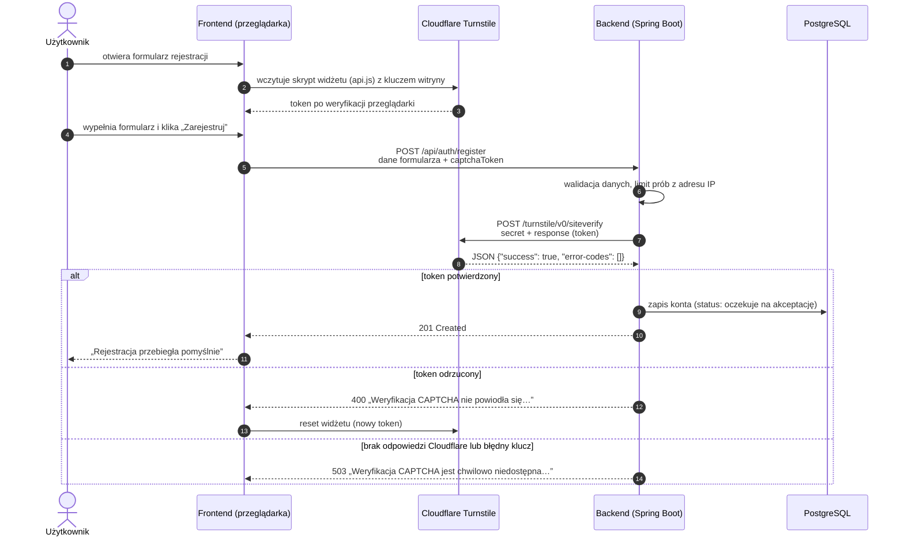

# Integracja z Cloudflare Turnstile

Aplikacja komunikuje się z zewnętrznym API **Cloudflare Turnstile**, które chroni formularze dostępne bez logowania przed botami (CAPTCHA). Integracja obejmuje trzy formularze:

| Formularz | Endpoint backendu | Wywołanie weryfikacji |
|---|---|---|
| Rejestracja konta | `POST /api/auth/register` | `AuthController.register` |
| Prośba o link do zmiany hasła | `POST /api/auth/forgot-password` | `AuthController.forgotPassword` |
| Zgłoszenie znalezionego gołębia | `POST /api/found-pigeons` | `FoundPigeonController.submitReport` |

## Zasada działania

W komunikacji biorą udział trzy strony: przeglądarka (frontend), backend aplikacji i serwery Cloudflare.

1. **Przeglądarka ↔ Cloudflare:** widżet Turnstile sprawdza w tle, czy formularz wypełnia człowiek, i przekazuje stronie jednorazowy **token**.
2. **Przeglądarka → backend:** token jest wysyłany razem z danymi formularza.
3. **Backend → API Cloudflare:** backend wysyła token i **klucz tajny** do endpointu `siteverify`, czyli wykonuje właściwe wywołanie zewnętrznego API.
4. **API Cloudflare → backend:** odpowiedź JSON mówi, czy token jest prawdziwy.
5. **Backend → przeglądarka:** zależnie od odpowiedzi formularz jest przyjmowany albo odrzucany.

Token **musi** sprawdzić serwer, nie przeglądarka:
- do weryfikacji potrzebny jest klucz tajny, który nie może trafić do przeglądarki;
- bot mógłby wysłać zmyślony token, a tylko Cloudflare potwierdzi, czy jest prawdziwy, niewykorzystany i nieprzeterminowany. Token jest jednorazowy i ważny 5 minut.



## Frontend

### Widżet (`components/TurnstileWidget.tsx`)

- **Skrypt:** wczytywany z `https://challenges.cloudflare.com/turnstile/v0/api.js?render=explicit` komponentem `<Script>` z Next.js.
- **Rysowanie widżetu:** po wczytaniu skryptu komponent wywołuje `window.turnstile.render(...)` z **kluczem witryny** (`NEXT_PUBLIC_TURNSTILE_SITE_KEY`). Ten klucz jest z założenia publiczny.
- **Funkcje zwrotne:**
  - `callback` przekazuje token do formularza przez `onTokenChange`;
  - `expired-callback` czyści token po jego wygaśnięciu;
  - `error-callback` pokazuje komunikat o błędzie wczytania widżetu.
- **Reset:** komponent udostępnia metodę `reset()`, która unieważnia bieżący token i rozpoczyna weryfikację od nowa.

### Formularz (`(auth)/register/page.tsx`)

- **Token:** jest trzymany w stanie `captchaToken`. Bez tokenu formularz się nie wyśle i pokaże komunikat „Dokończ weryfikację CAPTCHA…”.
- **Wysyłka:** po kliknięciu **Zarejestruj** formularz wywołuje `authService.register(...)` z danymi i polem `captchaToken`. `utils/apiClient.ts` wysyła je jako JSON do `POST /api/auth/register`, z nagłówkiem `X-XSRF-TOKEN` i ciasteczkami (`credentials: 'include'`).
- **Błąd:** formularz pokazuje komunikat z serwera i wywołuje `reset()` widżetu, bo token jest jednorazowy i kolejna próba potrzebuje nowego.

## Backend

### Kontroler (`controller/AuthController.java`)

```java
@PostMapping("/register")
public ResponseEntity<Void> register(@Valid @RequestBody RegistrationRequest request, HttpServletRequest httpRequest) {
    if (!authRateLimiter.tryAcquireRegistration(httpRequest.getRemoteAddr())) {
        throw new AuthRateLimitException("Zbyt wiele prób rejestracji. Spróbuj ponownie później.");
    }

    // CAPTCHA jest sprawdzana po limicie prób, żeby nie dało się wymuszać dowolnie wielu zapytań serwera do Cloudflare.
    turnstileService.verifyToken(request.captchaToken());

    breederService.registerNewBreeder(request);
    return ResponseEntity.status(HttpStatus.CREATED).build();
}
```

Kolejność kroków:
1. **Walidacja danych** (`@Valid`);
2. **limit prób** z adresu IP;
3. **weryfikacja CAPTCHA**;
4. **zapis konta.**

Limit jest sprawdzany przed CAPTCHA, żeby atakujący nie mógł zmusić serwera do nieograniczonej liczby zapytań do Cloudflare.

### Wywołanie API (`service/TurnstileService.java`)

Metoda `verifyToken` wysyła zapytanie do Cloudflare klientem HTTP `RestClient` ze Spring Framework:

```java
MultiValueMap<String, String> form = new LinkedMultiValueMap<>();
form.add("secret", secretKey);
form.add("response", token);

response = restClient.post()
        .uri(verifyUrl)
        .contentType(MediaType.APPLICATION_FORM_URLENCODED)
        .body(form)
        .retrieve()
        .body(TurnstileVerifyResponse.class);
```

- **Adres API:** `turnstile.verify-url` w `application.properties`, czyli `https://challenges.cloudflare.com/turnstile/v0/siteverify`.
- **Klucz tajny:** `turnstile.secret-key`, odczytywany ze zmiennej środowiskowej `TURNSTILE_SECRET_KEY`. Trafia do treści żądania, a nie do adresu, więc nie pojawia się w logach.
- **Limity czasu:** `spring.http.clients.connect-timeout` i `read-timeout` wynoszą po 5 sekund, więc awaria Cloudflare nie blokuje obsługi formularza.
- **Odpowiedź:** biblioteka Jackson zamienia JSON na rekord `dto/TurnstileVerifyResponse.java` z polami `success` i `error-codes`. Pozostałe pola odpowiedzi, np. czas weryfikacji i nazwa strony, są pomijane.

### Obsługa odpowiedzi

| Sytuacja | Reakcja backendu | Odpowiedź dla przeglądarki |
|---|---|---|
| `success: true` | metoda kończy się normalnie, formularz jest obsługiwany dalej | `201` (rejestracja, zgłoszenie) albo `204` (prośba o link) |
| Zły, wykorzystany lub przeterminowany token (np. `invalid-input-response`, `timeout-or-duplicate`) | `CaptchaVerificationException` | `400` „Weryfikacja CAPTCHA nie powiodła się. Spróbuj ponownie.” |
| Błąd konfiguracji lub Cloudflare (`missing-input-secret`, `invalid-input-secret`, `bad-request`, `internal-error`) | wpis w logu z kodami błędów i `CaptchaUnavailableException` | `503` „Weryfikacja CAPTCHA jest chwilowo niedostępna. Spróbuj ponownie później.” |
| Brak połączenia, przekroczony czas, błąd HTTP, pusta lub niepoprawna odpowiedź | wpis w logu i `CaptchaUnavailableException` | `503` jak wyżej |

Wyjątki zamienia na odpowiedzi HTTP `exception/GlobalExceptionHandler.java`.

Gdy Cloudflare nie odpowiada, formularz jest odrzucany (*fail closed*). Bezpieczniej chwilowo nie przyjąć rejestracji niż wpuścić boty.

## Przykładowa komunikacja

Przeglądarka → backend:

```http
POST /api/auth/register HTTP/1.1
Host: localhost:8080
Content-Type: application/json
X-XSRF-TOKEN: …

{"name": "Piotr", "surname": "Skrzydlak", "email": "piotr.skrzydlak@example.com", …,
 "password": "Demo.2026!", "captchaToken": "XXXX.DUMMY.TOKEN.XXXX"}
```

Backend → Cloudflare (tego zapytania nie widać w narzędziach przeglądarki, bo odbywa się między serwerami):

```http
POST /turnstile/v0/siteverify HTTP/1.1
Host: challenges.cloudflare.com
Content-Type: application/x-www-form-urlencoded

secret=1x0000000000000000000000000000000AA&response=XXXX.DUMMY.TOKEN.XXXX
```

Cloudflare → backend:

```json
{"success": true, "error-codes": []}
```

Do Cloudflare backend wysyła tylko klucz tajny i token. Dane formularza, np. imię, e-mail czy hasło, zostają w aplikacji.

## Klucze testowe i produkcyjne

Cloudflare udostępnia oficjalne klucze testowe, dzięki którym aplikacja działa bez konta w Cloudflare. Zapytanie do API i tak jest wysyłane naprawdę.

| Klucz | Wartość | Działanie |
|---|---|---|
| Klucz witryny (frontend) | `1x00000000000000000000AA` | widżet zawsze przechodzi i zwraca token `XXXX.DUMMY.TOKEN.XXXX` |
| Klucz tajny (backend) | `1x0000000000000000000000000000000AA` | API zawsze potwierdza token |
| Klucz tajny (backend) | `2x0000000000000000000000000000000AA` | API zawsze odrzuca token; służy do sprawdzenia obsługi błędu |

W prawdziwym wdrożeniu rejestruje się widżet i domenę w panelu Cloudflare i wpisuje jego klucze do `TURNSTILE_SECRET_KEY` i `NEXT_PUBLIC_TURNSTILE_SITE_KEY`. Kod się nie zmienia.

## Testy integracji

- **`TurnstileServiceTest`:** 8 testów jednostkowych. `MockRestServiceServer` udaje serwer Cloudflare i sprawdza:
  - czy zapytanie ma metodę `POST`, typ formularza i pola `secret` oraz `response`;
  - zachowanie przy sukcesie, złym tokenie, odpowiedzi bez kodu błędu, złym kluczu, błędzie serwera Cloudflare, braku połączenia i niepoprawnym JSON-ie.
- **Testy integracyjne kontrolerów:** zastępują `TurnstileService` atrapą (`@MockitoBean`), dzięki czemu nie zależą od internetu i mogą sprawdzić zarówno przyjęcie, jak i odrzucenie tokenu.
- **Testy Cypress:** podstawiają widżet Turnstile (`cy.mockTurnstile`) i odpowiedzi API, więc nie łączą się z Cloudflare. Sprawdzają też, że formularz nie wyśle się bez tokenu.

## Jak pokazać działanie integracji

1. **Debugger:** w IntelliJ ustaw breakpoint w `TurnstileService.verifyToken` przed wywołaniem `restClient.post()`, uruchom backend w trybie Debug i zarejestruj konto. Widać wtedy formularz z kluczem i tokenem, a po wykonaniu wywołania obiekt odpowiedzi Cloudflare.
2. **Odrzucenie tokenu:** ustaw w `backend/.env` klucz `TURNSTILE_SECRET_KEY=2x0000000000000000000000000000000AA` i uruchom backend ponownie. Rejestracja zakończy się komunikatem „Weryfikacja CAPTCHA nie powiodła się”.
3. **Błędny klucz:** wpisz dowolny niepoprawny klucz. Aplikacja zgłosi niedostępność weryfikacji, a w logu pojawi się wpis z kodem `invalid-input-secret` zwróconym przez Cloudflare.
4. **Narzędzia przeglądarki (F12 → Network):** widać zapytania do `challenges.cloudflare.com` (widżet) i do `/api/auth/register` (z polem `captchaToken`). Zapytania do `siteverify` tam nie ma, bo wysyła je serwer.

Po pokazie przywróć klucz testowy `1x…` i uruchom backend ponownie. Restart zeruje też limit 5 rejestracji na godzinę.
